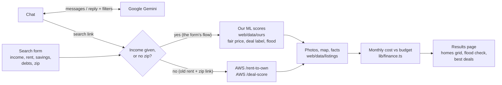
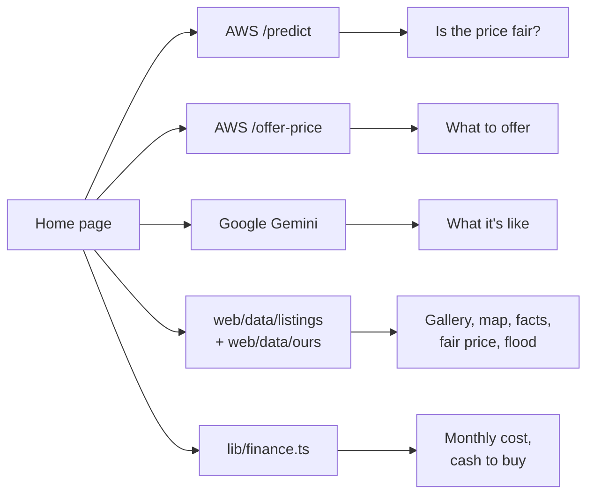

# How the data flows

### Search: form or chat → results page



### Home page



| Source | The site sends | It returns | The site uses it for |
| --- | --- | --- | --- |
| AWS `POST /rent-to-own` | `zip`, `monthly_rent`, `down_payment: 0`, `n_results: 100` | Homes with `price`, `predicted_price`, `delta_pct`, `tier`, beds, baths, sqft, one photo | Results grid and "Why it was picked", for old links that have rent and zip but no income |
| AWS `POST /deal-score` | `area` = the zip, `n_results: 40` | Homes with `deal_score`, `rating`, `value_gap_pct`, `days_on_zillow` | "Best deals in &lt;zip&gt;" under the results, same old-link case |
| AWS `POST /predict` | beds, baths, sqft, home type, lat, lon, rent and tax estimates (unknown fields left out) | `predicted_price`, `low_estimate`, `high_estimate` | "Is the price fair?" chart on every home page |
| AWS `POST /offer-price` | Exactly 8 fields: asking price, beds, baths, sqft, days on Zillow, home type, lat, lon | Model estimate and range, verdict, competitive / fair / negotiated offers with reasons | "What to offer" on every home page (offers above the asking price are flagged) |
| `web/data/ours` (ML notebook) | Looked up by zpid and zip, no network call | Fair price, % below fair, label (bargain, fair, overpriced, flood trap), zip flood score | Ranking for the income flow and Houston-wide search, fair-price and flood chips, flood check, "Best deals" in that flow |
| `web/data/listings` (Zillow CSV) | Looked up by zpid | 12 photos, coordinates, lot size, home type, Zestimate, rent estimate, tax value, days listed | Gallery, map, facts table, inputs for `/predict` and `/offer-price` |
| Google Gemini | Chat history; or one home's facts | Chat reply plus extracted zip, rent, household and filters; or a description | The chat's "Show matching homes" link; "What it's like" on each home page |
| `lib/finance.ts` (no model) | Price and the user's numbers | Monthly cost (loan, tax, insurance, PMI, HOA), budget, top price, cash to buy | Every monthly figure and "less than / more than your rent" badge |

The Lambda sends no CORS headers, so the browser never calls AWS directly. Each `/api` route calls it from the server and returns the Lambda URL it used as `upstream`. Without `MODEL_API_URL`, the AWS rows fall back to a stand-in model and the home-page sections that need AWS are hidden.

---

# Can I Own a Home?

A renter enters their zip code and monthly rent. A model picks homes for sale nearby that would cost about the same per month to own. The site shows each one as a listing presentation: photos, a short description generated from the listing facts, the monthly cost next to their rent, cash needed to buy, and how the asking price compares to estimates.

Houston area only for now.

## Layout

| Path | What |
| --- | --- |
| `web/` | Next.js 16 site, deployed to Vercel |
| `model/` | Recommendation model (model team) |
| `CONTRACT.md` | The model APIs the site calls, and what the site needs from them |

## Run the site

```sh
cd web
npm install
cp .env.example .env.local   # add GEMINI_API_KEY and MODEL_API_URL
npm run dev
```

Open http://localhost:3000. Without `MODEL_API_URL` the site uses a stand-in model over `web/data/listings`. Without `GEMINI_API_KEY` descriptions fall back to a one-line summary.

```sh
npm test          # vitest
npm run lint
npm run typecheck # run after `npm run build` once, it generates route types
```

## Deploy (Vercel)

1. Import the repo in Vercel and set **Root Directory** to `web`.
2. Environment variables:
   - `GEMINI_API_KEY`: server-side only. Never add a `NEXT_PUBLIC_` copy.
   - `GEMINI_MODEL`: optional, defaults to `gemini-3.5-flash` (falls back to `gemini-flash-lite-latest` when busy).
   - `MODEL_API_URL`: the model team's Lambda base URL (see `CONTRACT.md`).
3. In the Google Cloud console, set a quota or budget cap on the Gemini key. The app's per-IP limits (30 descriptions a minute, 15 chat messages a minute, 200 a day) are in memory per function instance and only stop bursts.

## Pages

- `/`: zip and rent form, and below it a chat where the user describes their household and needs. Gemini turns the conversation into search filters (bedrooms, bathrooms, size, yard, home type) and asks for whatever is missing. The search button appears once zip, rent and household size are known. Logic in `web/src/lib/chat.ts`, called through the server action in `web/src/app/actions.ts`.
- `/homes?zip=77044&rent=2200`: the recommended homes, with down payment, rate and term controls. Costs update live. Optional filters: `beds`, `baths`, `sqft`, `lot`, `type` (comma-separated home types).
- `/homes/[id]?zip=…&rent=…`: one home's presentation, with previous/next through the result list.

## Known gaps

- Photos and listing data are hotlinked from Zillow via the scraped dataset. That is fine for a class/demo build but not for a public launch; Zillow's terms forbid it. The real model API should return photos we are allowed to show.
- Tax and insurance are flat Houston averages, not per-property quotes.
- No accounts: assumptions are saved in the browser's localStorage only.
- Gemini descriptions are cached per listing for weeks (`use cache: remote`). A changed listing keeps its old description until the next deploy.
